# Mission Visualizer

Replay an AOC mission in your browser, with the flight-level instrument data, the MMR radar video beside it, a 2D or 3D map tracker, charts for any recorded variable, a cockpit Primary Flight Display, satellite imagery, the storm's best-track, tail Doppler radar, comparisons across flights, and clip recording.

It's built for the Aircraft Operations Center and runs entirely in your browser. The archive API adds conveniences on top, like browsing seasons, loading a mission by id, and archive GOES imagery, but you can still use the tool without it.

Tool: https://diegoxb07.github.io/AOCVisualizer/ (subject to change)

Repository: https://github.com/diegoxb07/AOCVisualizer

## Not sure where to start?

```mermaid
flowchart TD
    START(["Open the app"]) --> ARCHIVE{"Archive dropdowns available?<br>(Year / Storm / Flight)"}
    ARCHIVE -- "Yes" --> LOADARC["Pick <b>Year → Storm → Flight</b><br>click <b>⤓ Load Flight + Storm Track</b><br>(full-res NetCDF + storm best-track)"]
    ARCHIVE -- "No, API Offline banner" --> UPLOAD["Drop your <b>.nc</b> file<br>on the <b>Upload:</b> zone"]
    LOADARC --> LOADED["Flight loaded: map, charts populate"]
    UPLOAD --> LOADED
    LOADED --> MMR{"Have an MMR video<br>for this flight?"}
    MMR -- "Yes" --> VIDEO["Drop the <b>.mp4</b> in <b>Upload MMR to Sync</b><br>Auto-Sync reads the burned-in timestamp<br>and the time window matches the video<br><b>Sync Now</b> forces a lock, or use Manual"]
    MMR -- "No" --> SAT{"Want satellite imagery<br>behind the 2D track?"}
    VIDEO --> SAT
    SAT -- "Yes" --> FROMARC{"Is the API<br>online?"}
    FROMARC -- "Yes" --> SATGOES["<b>Overlays</b> → GOES East/West (archive)<br>pick a product; imagery pre-caches<br>for the whole flight"]
    FROMARC -- "No" --> SATPOLAR["<b>Overlays</b> → a MODIS/VIIRS pass<br>(works for any date, no API needed)"]
    SAT -- "No" --> TDRQ{"Want Tail Doppler Radar?<br>(needs the API online)"}
    SATGOES --> TDRQ
    SATPOLAR --> TDRQ
    TDRQ -- "Yes" --> TDRMODE["<b>TDR</b> (Overlays, map header)<br>radar on the tracker beside the MMR:<br>altitude layers, flight legs & two-point cross-sections"]
    TDRQ -- "No, or it reads TDR Unavailable" --> PLAY["<b>Play</b>, scroll through timeline, change speed,<br><b>Settings</b>: toggle Cockpit PFD / S.I Units"]
    TDRMODE --> PLAY
    PLAY --> EXPORT{"Need a deliverable?"}
    EXPORT -- "Briefing video" --> CLIP["Record Clip (.mp4)"]
    EXPORT -- "No, just analyzing" --> DONE(["Have fun!"])

    classDef decision fill:#fef3c7,stroke:#d97706,color:#78350f
    classDef data fill:#d1fae5,stroke:#059669,color:#064e3b
    classDef mmr fill:#ede9fe,stroke:#7c3aed,color:#4c1d95
    classDef sat fill:#cffafe,stroke:#0891b2,color:#164e63
    classDef tdr fill:#fce7f3,stroke:#db2777,color:#831843
    classDef playback fill:#dbeafe,stroke:#2563eb,color:#1e3a8a
    classDef term fill:#e2e8f0,stroke:#475569,color:#0f172a
    class ARCHIVE,MMR,SAT,FROMARC,TDRQ,EXPORT decision
    class LOADARC,UPLOAD,LOADED data
    class VIDEO,CLIP mmr
    class SATGOES,SATPOLAR sat
    class TDRMODE tdr
    class PLAY playback
    class START,DONE term
    %% linkStyle numbers = edge definition order above; update them if edges are added or reordered
    linkStyle 1,6,9,10,15 stroke:#059669,stroke-width:2px
    linkStyle 2,7,11,12,16,20 stroke:#dc2626,stroke-width:2px
```

## What you can use it for

For training, you can replay a real mission at any speed, slide to any moment, and watch the aircraft's attitude, winds, altitude, and speeds change on the map, the PFD, and the graphs, with the MMR video synced alongside. You can also record clips ahead of time for presentations.

For replay and analysis, you can load flight-level data or pull a whole mission from the archive, trim it to a time window, color the track by wind speed or temperature, draw measurement shapes, run point analyses, add satellite imagery for the flight's date, and record annotated clips.

When the API is up, you can browse the archive by Year, Storm, and Flight, and the app downloads the full mission and the storm's best-track for its whole life for you, along with GOES imagery from the archive for the dates the flights were flown.

## Loading a flight

You can load a flight in two ways, and since both use the same parser, the map, charts, PFD, and exports come out the same either way.

**From the archive** (needs the API online, which it usually is): pick a Year, Storm, and Flight in the **Load Mission** row and click **⤓ Load Flight + Storm Track**. You can also use the search box above the dropdowns, where typing a mission id loads it directly and typing a storm name finds that storm in every season. The app downloads and processes the mission's NetCDF along with the storm's best-track for its whole life, and the **↓ .nc** link lets you download the same file the app used. Refreshing the page clears everything and gives you a fresh session.

**Uploading it yourself** (works with the API offline): drop the `.nc` file, for example `20221028H1_A.nc`, on the "or upload:" box, which reads "Upload:" and moves next to the "API Offline" banner while the API is offline. A flight you upload yourself has no storm best-track.

Either way, the mission goes into **Previously Loaded Missions**, so you can reopen it or switch between flights later, even after a refresh. When you open a different flight, the MMR video is unloaded and the overlays go back to their defaults: satellite off at 100% opacity, TDR layers cleared, both sections folded, and Storm Track on.

A good first step is to click **⤓ Batch Load Flight Data** in the menu bar, pick a year, and check every mission you plan to look at, so they download in the background, get saved on this device, and open instantly afterwards.

If you see the archive dropdowns greyed out under an "API Offline" banner, the app can't reach the archive right now, and **⤓ Batch Load Flight Data** and **⤓ Pre-Cache Satellite Imagery** are greyed out too, so upload your file yourself in the meantime. The app checks the API every 60 seconds and turns the archive back on as soon as the API responds.

## Playback and the time window

`Play` and `Pause` start and stop playback, `« / 1x / »` change the speed, `↻ Reset` takes you back to the start of the window, and you can drag the timeline slider to any moment while the UTC time in the bottom left updates with it. **8Hz Smoothing** in the map header fills in the motion between the once-per-second samples, so the aircraft moves smoothly instead of in steps.

On the keyboard, press Space to play and pause, use the arrow keys to move through the timeline (hold them to go faster), and press Shift with an arrow key to jump 10 minutes of flight time.

Your display settings (units, tracker view, track and barb colors, PFD, HUDs, and smoothing) are remembered the next time you open the app.

## The map tracker

You can switch between the two views with the **2D Map Tracker / 3D Tracker** dropdown in the map header.

The 2D view is a world map of coastlines and US states with the satellite imagery and wind barbs drawn on it. Scroll to zoom and drag to pan, and zooming out shows you the wider weather picture, while airfield codes appear as you zoom in (KLAL always shows).

The 3D view shows terrain in the 2D map's colors, with hill shading that comes in as you lower the camera toward a side view so mountains stand out, the ocean getting darker from the shallow shelf to deep water, and a light haze toward the horizon. State names and nearby city names are drawn on the ground, along with a detailed aircraft model and the track at altitude (GPS or pressure, GPS by default), and you can pan and zoom with the mouse. **Real Scale (3D)** draws the aircraft at its true size and adds faint flight-level reference planes so you can see climbs and descents against them, which can look exaggerated.

In the **Settings** menu at the right end of the bottom bar, you can pick the **Track Color Type** (wind speed, or warming and cooling), the **Wind Barb Preset** (wind speed, or hurricane wind field), and the **3D Altitude Track** (GPS or pressure altitude for the 3D height), and turn **Metric HUD**, **Pitch HUD (3D)** (both on to start), and **Simple Icon (2D)** on or off. The ⛶ button makes any block fullscreen.

With hurricane wind field coloring, the barbs (and the track, in that mode) stay black until the flight-level data records hurricane-force winds, and from 64 kt up the color steps through the Saffir-Simpson categories, so a track that's black all the way means the aircraft never measured hurricane-force winds.

Click **Measure** in the 2D map header to draw a polygon, circle, or rectangle and get its distance and area, much like the tool the FDs have on the MMR. **Mark Point** in the bottom bar drops a marker at the aircraft's current position, and clicking that marker on the 2D map opens a point analysis you can download.

### TDR

You'll find the **TDR** section in the **Overlays** dropdown in the map header. While the first radar volume downloads, the button reads "TDR Loading...", and for missions flown without tail Doppler radar it's greyed out as "TDR Unavailable". Click **TDR** to unfold its controls.

The radar shows on whichever tracker you have open, 2D or 3D, while the MMR video keeps playing. When you unfold the section, the radar starts loading with every layer selected, and every layer comes back selected each time you unfold the section or switch between 2D and 3D, so you always see the radar right away. A selected layer shows a filled check box and a solid bar while an unselected one shows an empty box and a hollow bar, and you can click layers to narrow it down or click **None** to turn the radar off. In 3D the edges of each layer are drawn as solid walls, so the stack looks like a solid model of the storm with the layers showing through the top. The first time every leg finishes downloading, playback pauses and the playhead jumps to the end of the last leg so you can see all the radar at once, and the MMR video and satellite imagery jump with it while Auto-Sync rechecks the clock there. If none of the legs load, the section folds up and its button reads **TDR Failed to Load** and stays locked, and you can load the flight again to retry.

Under **TDR Legs**, each button is one radar leg, labeled with its number and time window (for example Leg 1 · 22:00-22:30Z). Click one to see just that leg as it looks at the end of the leg, and click it again to go back to all legs, or click **Jump to Eye** at the right of a leg's row to go to the moment the aircraft came closest to the storm center on that leg. **Layers** lists the levels grouped into bands that you can show alone or together, with **All** and **None** above them. Each band row shows the altitude range it covers and is labeled with the pressure that altitude would have in a *standard* atmosphere, and since the radar grid is in kilometers of height, think of the millibar value as a name for the height, because a storm's real pressure levels are further from it the deeper the storm is.

As you play through each leg, the radar fills in around the aircraft. Once you're using TDR, every leg downloads in the background so moving from one leg to the next is seamless, and where a later pass scanned the same area again, you see the newest data. In 3D, the white beam marks where the aircraft is, and while the radar shows, the view stays zoomed out over it: **Real Scale (3D)** turns off, you can zoom in only partway, and **Recenter on TDR** in the map header takes you back to the full view.

On the 2D map, drag the **TDR opacity** slider to see satellite imagery through the radar, and click **Draw a Cross-Section** to pick two points for a vertical slice, the same way you use the measure tool. Click **Cancel Cross-Section** or press Esc if you change your mind.

The visualizer only uses quality-controlled (level 2) TDR data from after the season, to keep the data as accurate and trustworthy as possible.

## MMR video sync

Load an MMR or nose-radar `.mp4` in the **Upload MMR to Sync** row. When you do, the tracker switches to 2D, every overlay turns off, and playback starts, so Auto-Sync has a moving clock to lock onto, and you have two ways to line the video up with the flight data.

**Auto-Sync** uses OCR to find the clock burned into the video anywhere in the frame (usually the bottom right, though exports vary) and locks onto the time that keeps advancing with the video, so any number on screen that stays still is ignored. You'll see a "Syncing" label while it searches, and while it syncs, the timeline slider is swapped for "Syncing MMR to flight data..." so scrubbing can't move the video in the middle of a scan. A short "Synced!" message confirms the lock. If it's slow to lock, click **Sync Now** a few times on a frame where the clock is easy to read. The app also checks each reading against the flight's own time range and throws out anything outside it.

If several scans find a likely timestamp but none of them can confirm it's ticking along with the video, the app locks onto that reading anyway and marks the sync as **unverified**, so compare the tracker time with the MMR before you rely on it. If nothing has locked within 30 seconds, try a plain MMR recording in place of the compiled nose-radar video, which puts the clock in an unusual spot and sometimes can't be synced at all.

**Manual Time Input**, which you pick in the sync dropdown of the **Upload MMR to Sync** row, gives you fields beside it for the flight-data start and end times and the video's UTC start time (**Flight Start**, **Flight End**, and **MMR Start**, all `HHMMSS`). It's tedious and easy to get wrong, so use it as a fallback.

If you don't have an MMR video yet, the **AVI to MP4 Converter** in the menu bar can make one: upload the raw `.avi` files for the storm you want and it joins them into one file. For recent years, you'll find those files under MMR in the SEB OMAO archive.

## Satellite overlays

Open **Overlays** in the map header and click the satellite section to unfold it, where **Satellite opacity** is the first row. Choose a satellite and a product, and click the product again if you want to turn the overlay off.

MODIS and VIIRS, the polar orbiters from NASA GIBS, are available for any date back to each mission's start. Their imagery is organized by calendar day, so you use the day-stepper to move between days, and the app looks up the overpass times for you.

GOES-East and GOES-West come from the archive and need the API. The imagery is made on the server for the flight's date and moves forward in 10-minute steps as you play. Any product the API can't provide right now is marked unavailable, and the daylight bands are unavailable at night.

**⤓ Pre-Cache Satellite Imagery** in the menu bar lets you download imagery for several flights at once, and it's saved on this device and still there after a reload.

The image on the map is from a slightly different time than the playback moment. Hover over the **Overlays** button to see when the image you're looking at is from and where that time came from: the real scan or overpass time from the archive, the 10-minute slot the app requested when the archive didn't return a scan time, or, for a polar orbiter, the single daily pass used for the whole flight.

The app loads the product list from the API when it starts, so new products show up without an app update. Both GOES satellites offer the full set of 16 ABI bands:

- Bands 1 to 6 are visible and near-IR, and work in daylight only. Band 2 (Red Visible, 0.64 µm) gives you the sharpest daytime cloud and convection detail, Band 3 (Veggie, 0.86 µm) shows land and vegetation better, and Band 5 (Snow/Ice, 1.6 µm) helps you tell ice clouds from water clouds.
- Band 7, shortwave IR at 3.9 µm, shows low clouds and fog at night.
- Bands 8 to 10, water vapor at 6.2, 6.9, and 7.3 µm, show upper, mid, and low-level moisture, dry slots, and shear.
- Bands 11 to 16, the IR window and trace-gas channels, show cloud-top temperature day or night, and Band 13 (Clean IR, 10.3 µm) also comes in IR Enhanced (ir4) and BD Curve (Dvorak) versions.

## Storm best-track

When you load a mission from the archive, you'll see the storm's best-track for its whole life on both trackers as a dashed line colored by intensity. It's on by default, and you can hide it with the **Storm Track** checkbox in **Overlays**.

The spinning cyclone marker shows roughly where the storm was at the current playback moment, estimated between the best-track points so it moves smoothly as you play, and hovering over a track point on the 2D map shows you its category, wind, pressure, and time.

## Charts, PFD and HUD

The eight charts (temperature, nav angles, flow angles, altitude, speeds, vertical speeds and accelerations, pressure, and thermodynamics) follow playback like everything else. Click ↺ to reset the zoom and ＋ to add or remove series, and scroll or drag to zoom and pan. The dashed **Create Graph** box under the charts lets you plot any variables in the file against each other.

You'll find the display filters in the **Settings** menu at the right end of the bottom bar. **Cockpit PFD** opens a primary flight display with an attitude ladder, airspeed, altitude, and heading tapes, a VSI, a bank scale with a slip/skid ball, a wind box, a ground-track diamond, and OAT/GS/TAS/IAS readouts, where the VSI, GS, and slip/skid ball are calculated from the data (the appendix explains how). **S.I Units** switches the readouts to metric, since they're imperial by default, and **GPS→Press Alt** switches the PFD altitude tape from GPS to pressure altitude when the file has both. The **Metric HUD** box on the map shows the live readings, and the **Pitch HUD (3D)** box shows pitch, roll, heading, and track on the 3D map. Both are on to start, and you can turn either one off there.

**8Hz Smoothing** in the map header fills in the motion between the 1-second samples so playback looks more fluid. The small extra motion it adds is simulated, and it grows with the recorded vertical wind, so calm legs stay smooth and only bumpy air shakes the aircraft, while a file with no vertical wind gets a faint fixed amount so the aircraft always moves a little.

That motion only changes how the aircraft is drawn, so the numbers stay true to the data: the Metric HUD shows the raw 1 Hz sample, and the PFD's altitude tape, altitude box, and RA readout use the smoothed values without the added motion.

## Comparing flights

**Metrics Across Flights** in the menu bar searches every flight you've loaded, or the ones you pick, for the highest or lowest value of a metric. It ranks the flights, gives you each one's peak with its time, altitude, and position, and draws them together on one comparison graph.

It works offline with whatever you've already loaded, and the flight you have open stays as it is.

## Recording a clip

In **Record Clip**, you pick a start and end time and see a preview of both, so you know the exact frames before you record. You can add the tracker view, a satellite overlay, the MMR video if you've loaded one, and up to four graphs, including custom graphs built from any variables just for that clip.

When you click **Start Recording**, the app draws the clip one frame at a time at full 1080p and saves it as an `.mp4`, using the playback speed and 3D camera angle you have set, so the result looks the same on any screen and never drops frames. Each frame has a title band with the mission and the UTC clock, the tracker filling its space, the MMR video and graph cards in a column on the right with large current values, and a timeline along the bottom. A progress card shows how far along it is, with **Stop and Save** to keep what's done so far and **Cancel** to drop it. This uses the browser's built-in video encoder (current Chrome, Edge, and Safari have it); in a browser without one, the app records the live view in real time instead, and the MMR audio is only included in that case.

## When something looks wrong

| What you see | What it means and what to do |
| --- | --- |
| The archive dropdowns are greyed out with an "API Offline" banner. | The app can't reach the archive right now, so upload your flights yourself. The app checks the API every 60 seconds and turns the archive back on as soon as the API responds. See [API & Connectivity](docs/CONNECTIVITY.md). |
| A GOES option is greyed out. | Either the API is offline, or the flight is outside that satellite's view of the Earth, so an Atlantic flight greys out GOES-West and an east Pacific flight greys out GOES-East. Use the other GOES satellite or MODIS/VIIRS. |
| You picked a GOES satellite but nothing shows. | With GOES you also need to pick a product under **Overlays**. |
| Auto-Sync locked onto the wrong time. | Click **Sync Now** on a frame where the burned-in clock is easy to read, hide any other timestamps on screen, or switch to **Manual Time Input**. |
| The charts and map don't update after you change the time window. | Press `Play`, which applies the new window before it starts. |
| Nothing plays. | Load a flight file first, then press `Play`. |
| Playback is slow with satellite imagery on. | Let the pre-cache finish, or cache the imagery ahead of time with **⤓ Pre-Cache Satellite Imagery**. |

There's one more doc next to this one: [API & Connectivity](docs/CONNECTIVITY.md) explains what the external API does, how the app checks whether it's online or offline, and exactly what works and what's turned off in each case.

## Running it, and how it's put together

**Running it.** Open https://diegoxb07.github.io/AOCVisualizer/ in a browser, or serve the repo folder with any static file server (`python3 -m http.server`, for example). Everything the page needs, including the libraries, fonts, basemap data, and the Auto-Sync OCR engine, is in the repo and served from the same site, so nothing loads from a CDN and you can replay uploaded files with no internet.

**How it's built.** It's plain HTML, CSS, and classic scripts with no build step. [index.html](index.html) has the markup, and the numbered files in `js/`, split by subsystem, share one global scope and load in order. File parsing runs in a web worker (`js/parse-worker.js`) so the page stays responsive while a large flight file parses, with a percent on the loading screen, and the worker, the page, and the tests all use the same parser core in `js/11b-parser-core.js`, so every path produces identical rows. Batch-loaded missions and satellite imagery are stored in IndexedDB, which is how they're still there after a reload.

**Offline (`sw.js`).** A service worker caches every file from the site (the page, css/js, libraries, fonts, basemap data, and OCR engine) on your first visit to the Pages URL and serves them from the cache after that, so once you've loaded the page online, it opens and replays flights with no network. [API & Connectivity](docs/CONNECTIVITY.md) has the full online/offline table.

Requests to other sites (the recon API, NASA GIBS, and the GeoJSON fallback) go straight to the network without caching, so the API health check still catches real outages and the "API Offline" banner keeps working. The deploy workflow stamps `CACHE_VERSION` in `sw.js` with the commit SHA (the same `sed` that stamps the `?v=` tokens), so every deploy installs a fresh cache, checks each file against the server instead of trusting the HTTP cache, and deletes the previous cache once it activates, with cached files matched ignoring the query string. The first load after a deploy still shows the old build while the new cache installs in the background, and the next reload shows the new one, so a replay you're in the middle of keeps running.

Two rules keep the offline cache working. Every css/js/font/data file you add or rename also has to go into `PRECACHE` in `sw.js`, because `cache.addAll` fails completely on a single 404 and the app then stays online-only with no warning. Cache names also keep the `aoc-viz-` prefix, because the `github.io` origin is shared with other project pages, so cleanup only ever deletes this app's own caches. The service worker registers only on `github.io`, so localhost previews skip it and always serve your working files.

**Deployment.** GitHub Pages through [.github/workflows/static.yml](.github/workflows/static.yml). The workflow rewrites every `?v=` cache-buster to the deploy's commit SHA, so each push reaches browsers fresh.

**Checks.** `node tests/run-tests.js` runs the QC checks against synthetic fixtures: the parser core, the longitude handling used for dateline crossings, the wind color ramps (whose steps are the Saffir-Simpson thresholds), and the lat/lon to pixel projection that every map layer goes through. A FLAG means one of those results differs from its independently computed expected value. The deploy workflow runs it on every push so the PASS/FLAG lines appear in the Actions log, and since it always exits 0, it reports problems without blocking a deploy. The rest of the app is canvas and DOM, which the checks can't reach, so test UI changes by opening the page and going through loading and playback.

## Where the data comes from

The flight data, MMR video, storm best-track, TDR, and archive GOES imagery all come from the NOAA sources below. Flight data, best-track, TDR, and GOES reach the app through the recon archive API, which relays and renders them, the MMR video is downloaded and converted separately, and MODIS/VIIRS along with the basemap and terrain files load directly.

**Flight-level data (NetCDF).** NOAA SEB Archive, `https://seb.omao.noaa.gov/pub/acdata/{year}/MET/{missionid}/`. The app loads a mission by id through the recon archive API at full resolution, and the `.nc` button links the original file. A mission folder can have more than one NetCDF, and the API serves the highest-lettered revision, so `_B` is used over `_A`, because the higher letter is the quality-assured pass and a lower one is an earlier version that may still have an error. You can upload a `.nc` (or `.txt`) yourself with no API.

**MMR video.** NOAA SEB Archive, `https://seb.omao.noaa.gov/pub/acdata/{year}/MMR/{missionid}/`, as zipped `.avi` segments. The built-in AVI to MP4 Converter unzips the segments and joins them into one `.mp4` on your device (with ffmpeg in the browser), which you then load as the MMR video. Converting a full mission's worth of video takes about 30 minutes, and the MMR player takes `.mp4` files.

**Storm best-track.** NHC ATCF best-track, the b-decks at `https://ftp.nhc.noaa.gov/atcf/btk/` for the current season and `https://ftp.nhc.noaa.gov/atcf/archive/` for past years. It covers the storm's whole life at roughly 6-hourly fixes, relayed by the recon archive API and looked up by year, storm name, and basin, and each fix has the time, lat, lon, wind (kt), pressure (mb), category, and status.

**TDR (tail Doppler radar).** NOAA AOML / Hurricane Research Division airborne tail Doppler radar (AOML HRD radar archive, `https://www.aoml.noaa.gov/ftp/pub/hrd/data/radar/`, with the analyses also stored in the AOC SEB archive). The recon archive API relays it as level 2 (quality-controlled) reflectivity, in 3D volumes and two-point vertical cross-sections.

**GOES (archive).** NOAA GOES ABI archive on AWS S3 (NOAA Open Data Dissemination, `https://registry.opendata.aws/noaa-goes/`, buckets `noaa-goes16` / `noaa-goes17` / `noaa-goes18` / `noaa-goes19`), rendered on the server by the recon archive API for the flight's date. GOES-East has been at 75W since 2017-07-10 and GOES-West at 137W since 2018-08-28, and the bands come from the API's product list.

**MODIS / VIIRS (polar), fetched directly from NASA.** Imagery from NASA GIBS at `https://gibs.earthdata.nasa.gov/wms/epsg4326/best/wms.cgi` (WMS GetMap, EPSG:4326, layer `{platform}_{band}`), with overpass times from NASA CMR at `https://cmr.earthdata.nasa.gov/search/granules.json` (short_name `MOD09` Terra, `MYD09` Aqua, `VNP09` Suomi-NPP, `VJ109` NOAA-20).

**Basemap, terrain, and airfields (bundled, with a remote fallback).** Coastlines from Natural Earth, `https://raw.githubusercontent.com/nvkelso/natural-earth-vector/master/geojson/ne_50m_admin_0_countries.geojson`, and US states from `https://raw.githubusercontent.com/PublicaMundi/MappingAPI/master/data/geojson/us-states.json`. Terrain comes from the ETOPO 0.5 degree grid, NOAA NCEI via CoastWatch ERDDAP (`etopo180`), baked into `data/etopo-heightmap.png`, and airfields from `data/airports.json`, which lists 1,486 fields.

## Appendix: flight-level variables and sensors

AOC flight-level files have hundreds of columns, and the visualizer reads only the quality-controlled subset it needs to plot: position, GPS/pressure/radar altitude, D-value, pressures, temperature and dew point, true and indicated airspeed, wind speed, direction and vertical wind, drift, heading, ground track, pitch and roll, angle of attack and sideslip, vertical acceleration, mixing ratio, and equivalent potential temperature. Those are the fields you see in the charts, PFD, HUDs, and Create Your Own Graph.

Most raw columns come from redundant sensors (`.1`, `.2`, `.3`, and so on), and after each flight a quality-assurance pass picks the best one as the reference and marks it with the `ref` suffix, for example `THDGref` or `LATref`. The app reads which sensor was chosen as the reference and shows that one.

Column suffixes: `.d` derived, `.c` corrected, `.N` sensor index, `ref` chosen reference. The families include INE (inertial), GPS, air-data unit (ADDU), dropsonde (`DS_`), and the SFMR surface-wind radiometer.

Values are stored in metric, and the readouts show imperial by default (feet, mph, °F), so check **S.I Units** if you want metric. Knots and nautical miles are always left as they are, and any variable missing from the file you loaded is greyed out.

## Appendix: how each value is computed

Everything the app plots is either read from the file as loaded or worked out from it in standard ways, as described below.

**Unit normalization.** Values are stored in metric. Where a source channel is in m/s, wind speed, true airspeed, and indicated airspeed are converted to knots (x 1.94384), and a radar altitude given in feet is converted to meters (x 0.3048). The S.I Units checkbox only changes what's displayed.

**Pressure altitude.** When a file is missing a recorded pressure altitude, the app works it out from static pressure `P` (mb) with the standard-atmosphere formula `alt_m = (1 - (P / 1013.25)^0.190284) x 44307.69`.

**NetCDF timestamps.** A mission NetCDF has a `TimeInterval` global attribute with the file's start and stop time. When it's there, the loader rebuilds the time column from it by spreading that span evenly across the rows in place of reading a time for each sample, which assumes a perfectly even sample rate. Since that's an assumption and not a reading, the parse summary lists it with the derived values ("timestamps reconstructed by spreading the file's TimeInterval evenly over the rows"), and it takes priority over whatever format the decoded column came in.

**Vertical speed (VSI).** The flight-level file has no vertical speed channel, so the PFD's VSI is the rate of change of altitude between consecutive cleaned samples, using pressure altitude first, then GPS, then radar altitude, and the first sample of a segment reads 0.

**Ground speed (GS).** The file has no ground speed either, so the PFD's GS is the great-circle distance between the samples on either side of the current one divided by the time between them. It's drawn in the muted color so you can tell it apart from the recorded OAT/TAS/IAS next to it.

**Slip/skid ball.** When the flight recorded a sideslip angle from the gust probe (`beta`), the ball shows that measurement, and when it didn't, the ball is estimated from the coordinated-turn relation `g*tan(roll) = V*(heading rate)` using the neighboring 1 Hz heading samples. That estimate assumes a steady coordinated turn and ignores the actual side force, so treat it as a rough guide.

**Relative humidity.** The point analysis' `COMPUTED RH` is the Magnus saturation-vapor-pressure ratio of dew point to ambient temperature, `100 * e(Td) / e(T)` with `e(x) = 6.11*exp(17.625x / (243.04 + x))` (Alduchov-Eskridge coefficients), clamped to 0-100%. Every other line in that report is read from the file, and a value missing from the row is left out with no default filled in.

**TDR layer pressures.** The radar analysis grid is indexed by altitude (0 to 18 km every 0.5 km), and the millibar labels on the band rows are those altitudes run backwards through the pressure-altitude formula above, which assumes a *standard* atmosphere with 1013.25 mb at sea level. A tropical cyclone's atmosphere is different, so read each label as a name for the height, and each band row also shows the actual altitude range it covers.

**Temperature baseline.** The warming and cooling track color compares each sample's ambient temperature to an average over the 300 samples on either side (about 5 minutes each way at 1 Hz), kept as a running sum so a long flight doesn't recompute the whole window at every step.

**8 Hz smoothing (playback interpolation).** For smooth playback, the map aircraft, PFD, and HUDs are interpolated between the 1-second samples at 8 Hz with a uniform Catmull-Rom spline for position, heading and ground track, pitch and roll, and altitude, with longitude and headings unwrapped the short way so a dateline crossing or a turn from 359 to 1 degree interpolates correctly. A small turbulence-based motion is then added so the aircraft always moves a little, with its size scaled by the recorded vertical wind (`vtWnd`, used as the turbulence measure) and its shape made of a few smooth sub-2 Hz waves, so calm legs stay steady and only bumpy air moves the aircraft. The 2D and 3D flight tracks are drawn along the same Catmull-Rom curve (one cubic Bezier per 1-second segment in 2D), so the aircraft always lines up with the track.

**Satellite day/night check.** The warning that you're looking at a daylight-only product (GOES reflective bands 1 to 6) after dark comes from the sun's elevation angle at the flight's position and time (`sunElevationDeg`, js/02-satellite.js). The app works out the days since J2000 to get the sun's mean longitude and anomaly, then its ecliptic longitude, declination, and right ascension, with the hour angle from GMST. Below -6 degrees, past civil twilight, it counts as night, and a product is turned off when 70% or more of the flight's sampled frames are dark.
